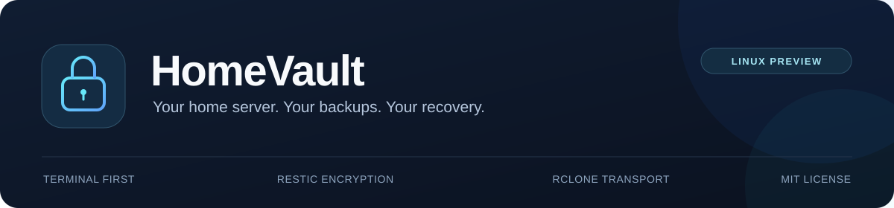
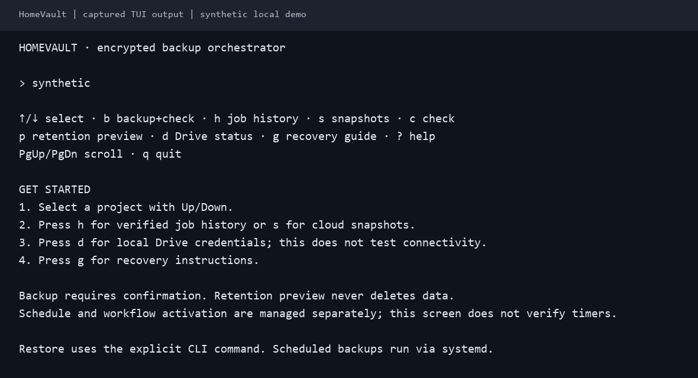

<p align="center">
  
</p>

<p align="center">
  <strong>Encrypted backups for your home server. Recovery you can verify.</strong>
</p>

<p align="center">
  <a href="https://github.com/iceswift/homevault/actions/workflows/ci.yml"></a>
  <a href="https://github.com/iceswift/homevault/releases/tag/v0.1.0-preview.2"></a>
  <a href="LICENSE"></a>
</p>

<p align="center">
  <a href="https://github.com/iceswift/homevault/releases/tag/v0.1.0-preview.2"><strong>Download Linux Preview</strong></a>
  &nbsp; · &nbsp; <a href="docs/RELEASING.md">Install &amp; verify</a>
  &nbsp; · &nbsp; <a href="docs/QUICKSTART.md">Try the local demo</a>
  &nbsp; · &nbsp; <a href="docs/ROADMAP.md">Roadmap</a>
</p>

HomeVault is a Go CLI/TUI for backing up selected files and prepared application
data. It brings project configuration, capture workflows, job history and recovery
checks together around **Restic** and **rclone**, with local or Google Drive storage.

> **Preview status:** Ubuntu/Linux amd64 is the tested runtime target. ARM64 is
> cross-built; runtime remains unverified. A successful backup does not prove
> application recovery. HomeVault does not create a bootable whole-server image.

<p align="center">
  <a href="#get-started">Get started</a> &nbsp; / &nbsp;
  <a href="#capabilities">Capabilities</a> &nbsp; / &nbsp;
  <a href="#verification">Verification</a> &nbsp; / &nbsp;
  <a href="#documentation">Documentation</a> &nbsp; / &nbsp;
  <a href="#faq">FAQ</a> &nbsp; / &nbsp;
  <a href="#contributing">Contributing</a>
</p>

## A look inside



<p align="center"><sub>Actual Linux TUI output with generated data, rendered as a terminal image.
<a href="docs/assets/README.md">Plain-text capture &amp; provenance</a>.</sub></p>

| Select a project | Run a reviewed backup | Verify recovery |
| --- | --- | --- |
| Browse projects and read job history. | Confirm before starting; capture-required apps use their reviewed workflow. | Restore into a separate target and validate the files and application. |

Press `b` to review backup confirmation, Enter to start, or another key to cancel.
Opening the TUI does not enable schedules or delete snapshots.

## Get started

**Begin with sample data. No cloud account or Docker needed.**

1. **[Download the Preview](https://github.com/iceswift/homevault/releases/tag/v0.1.0-preview.2)** — choose your Linux archive.
2. **[Verify and run](docs/RELEASING.md)** — check its checksum, then run the bundled local demo.
3. **Confirm the restored bytes match** before [configuring real data](docs/ONBOARDING.md) or [connecting Drive](docs/DRIVE-OAUTH.md).

The executable is prebuilt; you do not need Go. Install Restic separately. The
demo uses Bash and Python 3.11+; rclone is only needed for cloud storage. No sudo
or application data is needed once those dependencies are installed.

Trying HomeVault for the first time? Follow the [first-user trial](docs/FIRST-USER-TRIAL.md)
and report where you needed help. Independent first-user validation is still pending.

<details>
<summary><strong>Build from source instead</strong></summary>

Requires Git, Go 1.24.5+ and Restic for the local walkthrough:

```sh
git clone https://github.com/iceswift/homevault.git
cd homevault
go build -trimpath -o bin/homevault ./cmd/homevault
./bin/homevault version
```

Continue with the [copy-and-paste Quick Start](docs/QUICKSTART.md), including
expected results, byte-verified restore and troubleshooting.

</details>

<details>
<summary><strong>Try the next TUI design (mock data only)</strong></summary>

After building current main from source, run `./bin/homevault tui-demo`.
Browse sample Overview/Projects screens, filter and open details without loading
live config or running backup tools. Included in Preview 2; Preview 1 does not include this mode.

See the [prototype guide](docs/TUI-PROTOTYPE.md) for keyboard controls, narrow-screen
layouts, ASCII/monochrome modes and the fixed sample states.

</details>

<details>
<summary><strong>Read local workflow status (read-only, Preview 2+)</strong></summary>

Run `./bin/homevault tui-status --plan /absolute/reviewed-workflows.json` with an
existing coordinator plan. Overview/Projects read local metadata; `r` refreshes
manually. No engine actions, cloud checks, notifications or state writes occur.

Use `--context production` to label an explicitly selected real workflow plan.
Backup/check, source freshness, plan gates and recovery evidence are separate;
a disabled gate does not erase prior backup evidence.
See [read-only status and record scope](docs/TUI-STATUS.md). Missing local records
do not mean cloud backups are absent. Included in Preview 2; Preview 1 does not include this mode.

</details>

<details>
<summary><strong>Run reviewed manual file jobs (Preview 2+)</strong></summary>

Use `homevault --config /absolute/reviewed-files.json tui-jobs` for file-only
backup/check jobs with typed confirmation, recorded phases and cancellation.
Backup/check, source freshness and recovery evidence are displayed separately.
Use `--context lab` or `--context production` for an explicit operator label;
otherwise context is Unknown. Press `h` for local history or `d` for local
readiness diagnostics and suggested fixes (metadata only, no cloud probe).
This manual mode does not consume coordinator enabled flags/windows. Database and
capture projects remain blocked. See [scope and controls](docs/TUI-JOBS.md) before
using it. Included in Preview 2; Preview 1 does not include this mode.

</details>

## Capabilities

| Available | Experimental | Outside current scope |
| --- | --- | --- |
| Encrypted file backup, snapshots and guarded restore | Coordinated app captures and database preparation | Bootable disk images and complete host reconstruction |
| CLI/TUI, confirmation and recorded job history | Workflow templates, alerts, retention and recovery kits | Automatic production cutover |
| Local repositories and Google Drive through rclone | Selected application recovery rehearsals | Validated Windows deployment and ARM64 runtime |

<details>
<summary><strong>Full feature status and boundaries</strong></summary>

| Capability | Status / limits |
| --- | --- |
| Local encrypted backup, snapshots, check and guarded restore | Implemented; generated-data integration tests |
| CLI/TUI, backup confirmation, job history and detail scrolling | Implemented |
| Google Drive through rclone | Implemented; manual OAuth client setup and separate operator cloud-restore evidence |
| SQLite online export / PostgreSQL custom dump | Experimental; DB and media need coordinated capture |
| Pinned container capture and prepared workflows | Experimental; explicit configuration and activation |
| Discord alerts and systemd templates | Experimental; installation/preflight does not prove successful scheduled execution |
| Retention preview, reviewed apply and separate no-repack prune | Experimental; explicit review/confirmation; no automatic deletion |
| Recovery kits, image catalogs and isolated app recovery | Experimental; selected operator drills, not complete host recovery |

Windows builds/unit tests work, but deployment and restore are not validated.
Linux amd64 is the operator-tested target. ARM64 packages are cross-built only.
HomeVault does not discover every Docker volume or reconstruct your OS/routes.

</details>

### How it works

```text
Selected files / coordinated application exports
                      ↓
            HomeVault CLI / TUI
                      ↓
        Restic encrypted repository
                      ↓
      Local storage OR rclone → Google Drive
```

No always-running HomeVault daemon or public web server is required. Optional
systemd jobs run independently of SSH. Desktop OAuth uses a temporary loopback
callback; HomeVault does not choose a Google account from your open browser.

## Verification

| Evidence | What it covers | Boundary |
| --- | --- | --- |
| [Automated CI](https://github.com/iceswift/homevault/actions/workflows/ci.yml) | Go race tests/vet, generated-data Restic fixtures, public walkthrough and extracted-package amd64 backup/restore | No production credentials; not live Drive consent or arbitrary app recovery |
| [Operator VM drill](docs/VM-RECOVERY-DRILL.md) | Selected Drive snapshots; SQLite, PostgreSQL, JSON-state and static-site recovery | VM on the original physical server; not physical disk loss or complete host rebuild |
| [Operator validation](docs/OPERATOR-VALIDATION.md) | Key custody, selected captures and manual systemd preflight/monitor checks | Deployment-specific; no implied active schedule |

Details and skipped checks live in [testing](docs/TESTING.md). Preview status is
not a security audit. Schedules and retention depend on each deployment.

### Before real data

- Keep the **original repository key independently recoverable** outside the server.
- Prepare databases consistently; ordinary copies of a running database are insufficient.
- Restore into a fresh target and validate the application as well as the files.
- Keep keys, OAuth tokens, webhook URLs and private config out of Git and issues.

## Documentation

Release history and upgrade notes: **[Changelog](CHANGELOG.md)**.

| Start | Operate | Recover |
| --- | --- | --- |
| [Local Quick Start](docs/QUICKSTART.md) | [Jobs & alerts](docs/SCHEDULING-ALERTS.md) | [Recovery kit](docs/RECOVERY-KIT.md) |
| [Installation & checksums](docs/RELEASING.md) | [Prepared workflows](docs/PLANNED-WORKFLOWS.md) | [Rebuild runbook](docs/REBUILD.md) |
| [Project onboarding](docs/ONBOARDING.md) | [Databases](docs/DATABASE-BACKUPS.md) · [Fresh capture](docs/FRESH-CAPTURE.md) | [Application rehearsal](docs/RECOVERY-REHEARSAL.md) |
| [Google Drive OAuth](docs/DRIVE-OAUTH.md) | [Retention](docs/RETENTION.md) · [Prune](docs/PRUNE.md) | [Verification evidence](docs/VM-RECOVERY-DRILL.md) |

## FAQ

<details>
<summary><strong>Does this back up my entire server?</strong></summary>

HomeVault backs up selected files and prepared application data. It does not make
a bootable disk image or automatically reconstruct your operating system and services.

</details>

<details>
<summary><strong>Do I need another disk or a Google account?</strong></summary>

Cloud backups do not require a second disk in the source server, but captures,
caches and restores still need local space. Google Drive is optional; the local
demo works without a cloud account.

</details>

<details>
<summary><strong>What happens if I lose the repository key?</strong></summary>

If every recoverable copy is lost, HomeVault cannot decrypt the repository for you.
Keep the original key independently recoverable outside the server and test recovery.

</details>

<details>
<summary><strong>Why use HomeVault instead of Restic directly?</strong></summary>

HomeVault adds project configuration, a TUI, job history and reviewed capture/recovery
workflows around Restic and rclone. If your existing scripts meet your needs, you
may not need HomeVault. No performance or reliability superiority is claimed.

</details>

[Read all FAQs](docs/FAQ.md) for database consistency, schedules, platform support,
retention and what a successful backup actually proves.

## Contributing

Documentation fixes, UX feedback and focused code changes are welcome.
[Contribution guide](CONTRIBUTING.md) · [Issue forms](https://github.com/iceswift/homevault/issues/new/choose) · [Roadmap](docs/ROADMAP.md)

For vulnerabilities, use the **private channel** in [SECURITY.md](SECURITY.md).
Never attach real backup data, credentials or private configuration to reports.

---

<p align="center">
  <sub>MIT licensed · Built around <a href="https://restic.net/">Restic</a> and <a href="https://rclone.org/">rclone</a> · Independent open-source project</sub>
</p>
