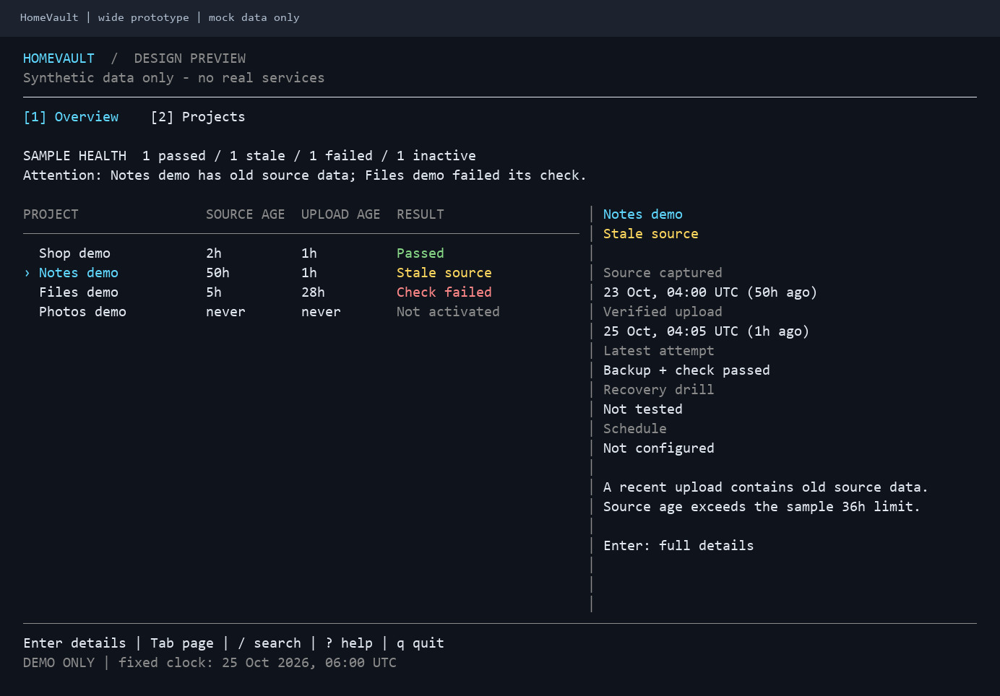
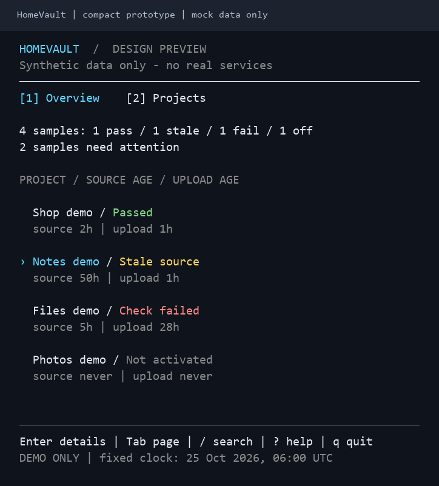

# TUI design prototype (mock data only)

This is step 1 of the redesign: an interactive, synthetic UI for reviewing layout
and keyboard navigation. It is available on main/subsequent CI builds, **not** in
the published `v0.1.0-preview.1`. The existing `tui` command is unchanged.

## Try it

Build from source as described in the README, then run:

```sh
./bin/homevault tui-demo
```

No config, Restic/rclone, cloud account, database or Docker is needed. The command
is handled before live config loading/tool discovery. It does not initialize a
repository, write application state, upload, stop services or enable timers.
Every screen is labelled `DESIGN PREVIEW` / `DEMO ONLY`.

This is different from `demo-setup` and the local backup Quick Start: those create
sample files and exercise real encrypted backup/restore. `tui-demo` only displays
in-memory sample state.

## Layouts

| Terminal | Layout |
| --- | --- |
| 110+ columns | Project table and selected-project preview side by side |
| 80-109 columns | Compact table; Enter opens full details |
| 40-79 columns | Vertical project cards; selected card stays visible |
| Below 40 columns or 18 rows | Resize guidance and quit controls |

Overview summarizes the four fixed samples; Projects focuses on browsing/filtering.
Full details separate source capture age, verified-upload age, latest attempt,
recovery evidence and schedule state. Detail/help content scrolls rather than
exceeding the available terminal height.

### Captured prototype screens

Actual prototype PTY output, rendered with its ANSI colors. All project states,
ages and recovery notes are synthetic fixtures.





[Plain-text captures and provenance](assets/README.md#design-prototype-captures).

## Controls

| Key | Effect |
| --- | --- |
| Tab / Shift+Tab, `1` / `2` | Switch Overview / Projects |
| Up/Down or `k`/`j` | Select a sample; scroll when in full details |
| Enter | Open details; apply a filter while editing |
| `/` | Filter by project name or source type |
| Esc | Back from details/help; clear a filter when browsing/editing |
| Page Up / Page Down | Scroll details/help or move through the list |
| `?` | Contextual prototype help |
| `q` / Ctrl+C | Quit; `q` remains a search character while editing |
| Backup/check/restore action keys | Explain that no job was started; no engine action exists |

Use `--ascii` for simple separators/cursor and `--no-color` for monochrome.
`NO_COLOR` is honored; `TERM=dumb` selects ASCII/monochrome. Status words remain
visible without color. There is no animation or periodic data polling.

```sh
./bin/homevault tui-demo --ascii --no-color
./bin/homevault tui-demo --page projects --project notes --details
./bin/homevault tui-demo --render --width 120 --height 32
./bin/homevault tui-demo --render --width 60 --height 26 --project notes
```

`--render` prints one deterministic, uncolored frame, without opening a terminal.
Width/height flags set the initial/render dimensions; terminal resize events take
precedence interactively. `--project` selects only `shop`, `notes`, `files` or
`photos`, never a live project. `--help` lists the supported flags.

## Sample states, not operational evidence

The clock is fixed at 25 October 2026, 06:00 UTC. All ages, results and recovery
notes are invented fixtures, not observations of the operator's server.

- Shop: backup/check passed, with separate sample recovery evidence.
- Notes: recent upload passed but the captured source is 50 hours old; it stays stale.
- Files: the latest check failed; the previous verified-upload timestamp is preserved.
- Photos: not activated, with no verified backup and unknown recovery state.

No recovery success is inferred from an upload or repository check. Mock schedules
are not configured/activated. The prototype cannot inspect Drive, snapshots,
systemd or actual freshness; those belong to a later read-only integration stage.

## Review before connecting real data

Try Overview -> filter -> project details -> back on a desktop and a narrow SSH
terminal. Check whether selection/context stay understandable, errors stand out
without color and the source/upload/recovery distinctions are clear.

Future stages may add read-only live providers and, separately, explicit reviewed
actions. This prototype does not authorize either and contains no engine reference.
